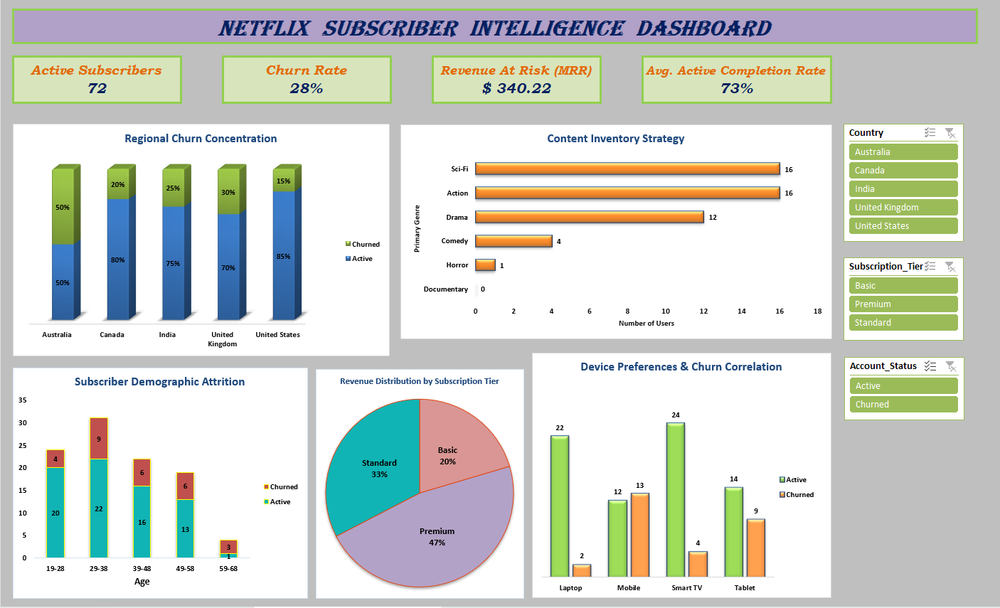

# Netflix Subscriber Analytics Dashboard (Excel)

## 📌 Project Overview
An interactive Excel dashboard analyzing customer behavior and churn vectors to safeguard Monthly Recurring Revenue (MRR) for executive-level decision making.

## 📊 Business Key Metrics (KPIs)
* **Active Subscribers:** `72` users currently retained
* **Churn Rate:** `28%` subscriber attrition rate
* **Revenue At Risk (MRR):** `$340.22` linked to churned accounts
* **Avg. Active Completion Rate:** `73%` content engagement level

## 🔍 Top 3 Data Insights
* **Demographic Attrition:** The **29–38 age group** is the largest customer segment but suffers the highest churn (**9 accounts lost**).
* **Device Risk:** **Mobile users** exhibit severe instability, where churned accounts (`13`) outnumber active users (`12`). 
* **Geographic Variance:** The **United Kingdom** leads regional churn at **30%**, while the **United States** shows the best retention (**85% active**).

## 🛠️ Technical Excel Features Implemented
* **Advanced Data Aggregation:** **Pivot Tables** used to calculate specialized SaaS metrics like Churn Percentage and Revenue-at-Risk.
* **Data Visualization & Design:** Built custom nested stacked bar charts, horizontal bar distributions and multi-series column charts.
* **Interactive Slicers:** Deployed dynamic, cross-connected filters for **Country, Subscription Tier, and Account Status** to enable real-time dashboard drilling.
* **UI/UX Architecture:** Designed a high-contrast executive interface utilizing clear color-coding (Silver/Grey for Active, Crimson Red for Churned) to enhance scannability.

## 📁 Repository Structure
* `Netflix_Subscriber_Intelligence_Dashboard.xlsx` (Includes both the interactive **Dashboard** and the **Raw Data** sheets).
* `netflix-subscriber-dashboard.png` (Dashboard preview image).
